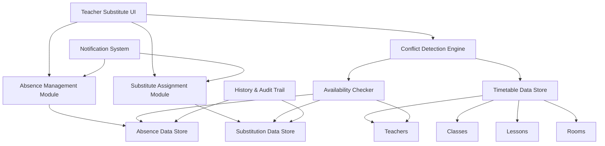
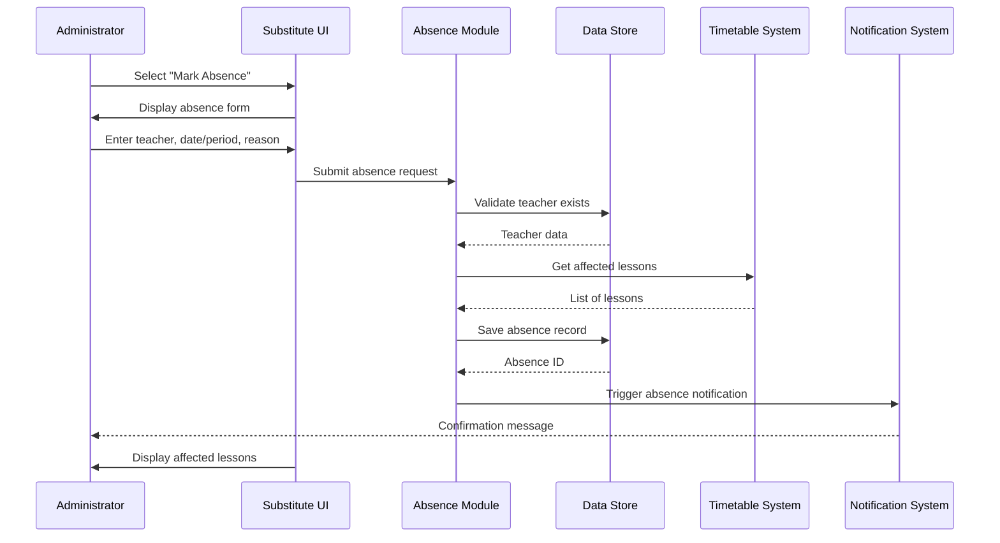
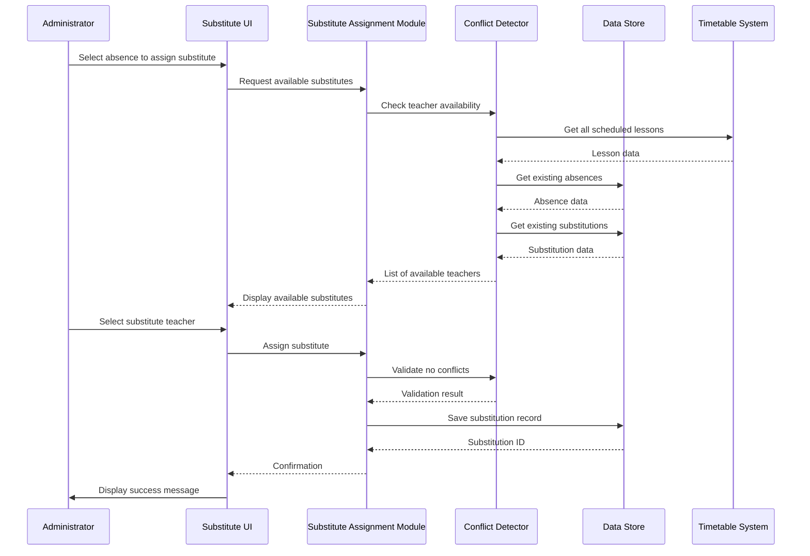

# Design Document: Teacher Substitute Management

## Overview

The Teacher Substitute Management feature enables schools to efficiently manage teacher absences and assign substitute teachers while maintaining timetable integrity. This system integrates with the existing timetable management platform to provide real-time absence tracking, automatic conflict detection, and seamless substitute assignment workflows. The feature ensures that when a teacher is absent, their scheduled lessons are covered by qualified substitutes without creating scheduling conflicts or leaving classes unattended.

## Architecture



## Sequence Diagrams

### Marking Teacher Absence



### Assigning Substitute Teacher



## Components and Interfaces

### Component 1: Absence Management Module

**Purpose**: Handles creation, modification, and deletion of teacher absence records

**Interface**:
```typescript
interface AbsenceManagementModule {
  createAbsence(absence: AbsenceRequest): AbsenceRecord
  updateAbsence(absenceId: number, updates: Partial<AbsenceRequest>): AbsenceRecord
  deleteAbsence(absenceId: number): boolean
  getAbsenceById(absenceId: number): AbsenceRecord | null
  getAbsencesByTeacher(teacherId: number, dateRange?: DateRange): AbsenceRecord[]
  getAbsencesByDate(date: Date): AbsenceRecord[]
  getAffectedLessons(absenceId: number): Lesson[]
}
```

**Responsibilities**:
- Validate absence data before saving
- Track which lessons are affected by each absence
- Maintain absence history for audit purposes
- Provide search and filter capabilities for absences

### Component 2: Substitute Assignment Module

**Purpose**: Manages the assignment of substitute teachers to cover absent teachers' lessons

**Interface**:
```typescript
interface SubstituteAssignmentModule {
  assignSubstitute(substitution: SubstitutionRequest): SubstitutionRecord
  updateSubstitution(substitutionId: number, updates: Partial<SubstitutionRequest>): SubstitutionRecord
  removeSubstitution(substitutionId: number): boolean
  getSubstitutionById(substitutionId: number): SubstitutionRecord | null
  getSubstitutionsByAbsence(absenceId: number): SubstitutionRecord[]
  getSubstitutionsByTeacher(teacherId: number, dateRange?: DateRange): SubstitutionRecord[]
  autoSuggestSubstitutes(absenceId: number): Teacher[]
}
```

**Responsibilities**:
- Assign substitute teachers to specific lessons or entire absence periods
- Support both manual and automatic substitute suggestions
- Track substitution history for reporting
- Handle substitution modifications and cancellations

### Component 3: Conflict Detection Engine

**Purpose**: Ensures substitute assignments don't create scheduling conflicts

**Interface**:
```typescript
interface ConflictDetectionEngine {
  checkTeacherAvailability(teacherId: number, date: Date, period: number): AvailabilityStatus
  validateSubstitution(substitution: SubstitutionRequest): ValidationResult
  getAvailableTeachers(date: Date, period: number, filters?: TeacherFilter): Teacher[]
  detectConflicts(teacherId: number, dateRange: DateRange): Conflict[]
  checkRoomAvailability(roomId: number, date: Date, period: number): boolean
}
```

**Responsibilities**:
- Check if substitute teacher is already scheduled during the period
- Verify substitute teacher is not marked absent for the same period
- Detect room conflicts if rooms are assigned
- Validate against teacher availability constraints
- Provide detailed conflict information for resolution

### Component 4: History & Audit Trail Module

**Purpose**: Maintains comprehensive records of all absence and substitution activities

**Interface**:
```typescript
interface HistoryAuditModule {
  logAbsenceAction(action: AuditAction): void
  logSubstitutionAction(action: AuditAction): void
  getAbsenceHistory(absenceId: number): AuditRecord[]
  getSubstitutionHistory(substitutionId: number): AuditRecord[]
  generateReport(reportType: ReportType, filters: ReportFilters): Report
  exportHistory(format: ExportFormat, filters: ReportFilters): File
}
```

**Responsibilities**:
- Log all create, update, delete operations
- Track who made changes and when
- Generate reports on absence patterns and substitution usage
- Support data export for external analysis

### Component 5: Notification System (Optional)

**Purpose**: Sends notifications about absences and substitution assignments

**Interface**:
```typescript
interface NotificationSystem {
  notifyAbsenceCreated(absence: AbsenceRecord): void
  notifySubstituteAssigned(substitution: SubstitutionRecord): void
  notifySubstituteRemoved(substitution: SubstitutionRecord): void
  configureNotificationPreferences(userId: number, preferences: NotificationPreferences): void
}
```

**Responsibilities**:
- Send notifications to relevant stakeholders
- Support multiple notification channels (email, SMS, in-app)
- Allow users to configure notification preferences
- Queue and batch notifications for efficiency

## Data Models

### Model 1: AbsenceRecord

```typescript
interface AbsenceRecord {
  id: number
  teacherId: number
  absenceType: 'full-day' | 'partial-day' | 'date-range'
  startDate: Date
  endDate: Date | null
  periods: number[] | null
  reason: string
  status: 'pending' | 'confirmed' | 'cancelled'
  affectedLessonIds: number[]
  createdBy: number
  createdAt: Date
  updatedAt: Date
  notes: string | null
}
```

**Validation Rules**:
- teacherId must reference an existing teacher
- startDate is required and cannot be in the past (except for emergency entries)
- endDate must be >= startDate if provided
- periods array is required for partial-day absences
- absenceType determines which fields are required
- reason is required and must be non-empty

### Model 2: SubstitutionRecord

```typescript
interface SubstitutionRecord {
  id: number
  absenceId: number
  substituteTeacherId: number
  lessonId: number
  date: Date
  period: number
  status: 'assigned' | 'confirmed' | 'completed' | 'cancelled'
  assignmentType: 'manual' | 'automatic'
  roomId: number | null
  notes: string | null
  createdBy: number
  createdAt: Date
  updatedAt: Date
}
```

**Validation Rules**:
- absenceId must reference an existing absence record
- substituteTeacherId must reference an existing teacher
- substituteTeacherId cannot be the same as the absent teacher
- lessonId must reference an existing lesson
- date and period must match the absence record
- Substitute teacher must be available (no conflicts) at the specified date/period

### Model 3: AvailabilityStatus

```typescript
interface AvailabilityStatus {
  isAvailable: boolean
  conflicts: Conflict[]
  reason: string | null
}

interface Conflict {
  type: 'scheduled-lesson' | 'existing-absence' | 'existing-substitution' | 'unavailable-period'
  description: string
  conflictingItemId: number
  date: Date
  period: number
}
```

**Validation Rules**:
- isAvailable is true only when conflicts array is empty
- Each conflict must have a valid type and description
- conflictingItemId must reference the actual conflicting record

### Model 4: AbsenceRequest

```typescript
interface AbsenceRequest {
  teacherId: number
  absenceType: 'full-day' | 'partial-day' | 'date-range'
  startDate: Date
  endDate?: Date
  periods?: number[]
  reason: string
  notes?: string
}
```

**Validation Rules**:
- All required fields based on absenceType must be provided
- Date validations as per AbsenceRecord
- periods must be valid period numbers from the timetable configuration

### Model 5: SubstitutionRequest

```typescript
interface SubstitutionRequest {
  absenceId: number
  substituteTeacherId: number
  lessonId: number
  date: Date
  period: number
  roomId?: number
  notes?: string
}
```

**Validation Rules**:
- All fields except optional ones must be provided
- Must pass conflict detection validation
- roomId if provided must reference an existing room

### Model 6: DateRange

```typescript
interface DateRange {
  startDate: Date
  endDate: Date
}
```

**Validation Rules**:
- endDate must be >= startDate
- Both dates are required

### Model 7: AuditRecord

```typescript
interface AuditRecord {
  id: number
  entityType: 'absence' | 'substitution'
  entityId: number
  action: 'create' | 'update' | 'delete'
  userId: number
  timestamp: Date
  changes: Record<string, any>
  previousValues: Record<string, any> | null
}
```

**Validation Rules**:
- All fields are required
- changes object must contain at least one field
- previousValues is null for create actions

## Error Handling

### Error Scenario 1: Teacher Already Absent

**Condition**: Attempting to mark a teacher absent when they already have an absence record for the same date/period
**Response**: Display error message: "Teacher is already marked absent for this date/period. Please edit the existing absence record."
**Recovery**: Redirect user to edit the existing absence record or cancel the operation

### Error Scenario 2: Substitute Teacher Unavailable

**Condition**: Attempting to assign a substitute who is already scheduled or absent during the target period
**Response**: Display detailed conflict information showing why the teacher is unavailable
**Recovery**: Suggest alternative available teachers or allow user to select a different substitute

### Error Scenario 3: No Available Substitutes

**Condition**: No teachers are available to substitute for a particular lesson
**Response**: Display warning: "No available substitutes found for this period. Consider adjusting lesson schedules or marking the lesson as uncovered."
**Recovery**: Allow user to:
- View all teachers with their conflicts
- Mark lesson as "uncovered" for manual resolution
- Adjust the timetable to free up a teacher

### Error Scenario 4: Invalid Date Range

**Condition**: User enters an end date before the start date, or dates in the past
**Response**: Display validation error with specific issue
**Recovery**: Highlight the invalid field and prevent form submission until corrected

### Error Scenario 5: Deletion of Absence with Assigned Substitutes

**Condition**: Attempting to delete an absence that has substitute teachers already assigned
**Response**: Display confirmation dialog: "This absence has X substitutes assigned. Deleting will remove all substitutions. Continue?"
**Recovery**: 
- If confirmed: Delete absence and all related substitutions, log in audit trail
- If cancelled: Return to absence management view

### Error Scenario 6: Data Persistence Failure

**Condition**: Database or storage operation fails
**Response**: Display error: "Failed to save changes. Please try again."
**Recovery**: 
- Retain user's input in the form
- Provide retry button
- Log error details for debugging

## Testing Strategy

### Unit Testing Approach

**Key Test Cases**:
1. **Absence Creation**: Test all absence types (full-day, partial-day, date-range) with valid and invalid data
2. **Conflict Detection**: Test various conflict scenarios (double-booking, absent substitute, room conflicts)
3. **Substitution Assignment**: Test manual and automatic assignment workflows
4. **Data Validation**: Test all validation rules for each data model
5. **Edge Cases**: Test boundary conditions (same-day absences, overlapping date ranges, maximum periods)

**Coverage Goals**: Minimum 80% code coverage for all modules, 100% for conflict detection logic

### Property-Based Testing Approach

**Property Test Library**: fast-check (for JavaScript/TypeScript)

**Key Properties to Test**:

1. **Property: Absence Date Consistency**
   - For any valid absence record, startDate <= endDate (if endDate exists)
   - Generate random absence records and verify date ordering

2. **Property: No Double Substitution**
   - For any teacher and time slot, there should be at most one substitution assignment
   - Generate random substitution assignments and verify uniqueness

3. **Property: Conflict Detection Symmetry**
   - If teacher A conflicts with slot S, then checking A's availability for S should always return unavailable
   - Generate random teacher schedules and verify consistency

4. **Property: Substitution Validity**
   - Any valid substitution must reference an existing absence, teacher, and lesson
   - Generate random substitutions and verify referential integrity

5. **Property: Audit Trail Completeness**
   - Every create/update/delete operation must generate exactly one audit record
   - Perform random operations and verify audit log count matches

### Integration Testing Approach

**Key Integration Tests**:
1. **Timetable Integration**: Verify absence and substitution data correctly integrates with existing timetable display
2. **End-to-End Workflow**: Test complete flow from marking absence to assigning substitute to viewing updated timetable
3. **Data Persistence**: Verify data is correctly saved and retrieved across page reloads
4. **Multi-User Scenarios**: Test concurrent absence/substitution operations (if applicable)

## Performance Considerations

### Conflict Detection Optimization

**Challenge**: Checking teacher availability requires scanning all lessons, absences, and substitutions
**Solution**: 
- Implement indexed data structures (Map/Set) for O(1) lookups by teacher ID and date
- Cache availability results for frequently checked teachers
- Use lazy loading for date ranges - only load data for visible date range

**Expected Performance**: Availability check should complete in < 100ms for typical school size (50 teachers, 1000 lessons)

### Data Loading Strategy

**Challenge**: Loading all historical absence and substitution data can be slow
**Solution**:
- Implement pagination for history views (show 50 records per page)
- Use date-based filtering to limit data loaded
- Lazy load detailed information only when user expands a record

**Expected Performance**: Initial page load < 2 seconds, subsequent navigation < 500ms

### Search and Filter Performance

**Challenge**: Searching through large datasets of absences and substitutions
**Solution**:
- Implement client-side filtering for small datasets (< 1000 records)
- Use debounced search input to reduce unnecessary filtering operations
- Consider server-side search for larger deployments

## Security Considerations

### Access Control

**Requirement**: Only authorized users (administrators, schedulers) should be able to manage absences and substitutions
**Implementation**:
- Implement role-based access control (RBAC)
- Verify user permissions before allowing create/update/delete operations
- Log all access attempts in audit trail

### Data Privacy

**Requirement**: Absence reasons may contain sensitive personal information
**Implementation**:
- Restrict visibility of absence reasons to authorized personnel only
- Implement field-level access control
- Consider data encryption for sensitive fields

### Audit Trail Integrity

**Requirement**: Audit logs must be tamper-proof for compliance
**Implementation**:
- Make audit records immutable (no updates or deletes)
- Include cryptographic hash of record contents
- Store audit logs separately from operational data

## Dependencies

### Internal Dependencies

1. **Timetable Data Store**: Requires access to existing teachers, classes, lessons, and rooms data
2. **Timetable Display Module**: Must integrate with existing timetable viewing functionality
3. **User Authentication System**: Requires user identity for audit logging and access control

### External Dependencies

1. **Date/Time Library**: date-fns or moment.js for date manipulation and validation
2. **UI Component Library**: Existing UI framework (appears to be custom CSS with Font Awesome icons)
3. **Data Persistence**: localStorage or backend API for data storage
4. **Notification Service** (Optional): Email/SMS service for sending notifications (e.g., SendGrid, Twilio)

### Browser Requirements

- Modern browsers with ES6+ support
- localStorage support for data persistence
- No specific polyfills required based on existing codebase

## Integration Points with Existing System

### 1. Data Store Integration

**Current System**: Uses JavaScript arrays (teachers, classes, lessons, subjects, rooms) stored in memory
**Integration Approach**:
- Add new arrays: `absences = []` and `substitutions = []`
- Follow existing data structure patterns (objects with id, name, etc.)
- Implement similar CRUD functions as existing modules

### 2. UI Integration

**Current System**: Modal-based UI with form inputs and tables
**Integration Approach**:
- Create new page: `teacher-substitute.html` (similar to `generate-timetable.html`)
- Reuse existing CSS classes from `timetable-styles.css`
- Follow existing modal patterns for absence and substitution forms
- Add navigation link from `index.html` (Teacher Substitute card already exists)

### 3. Timetable Display Integration

**Current System**: `view-timetable.html` displays generated timetables in grid format
**Integration Approach**:
- Add visual indicators for lessons with absent teachers
- Show substitute teacher information in lesson cards
- Add filter option to view only substituted lessons
- Highlight substitutions with distinct color coding

### 4. Navigation Integration

**Current System**: Card-based navigation on `index.html`
**Integration Approach**:
- Link existing "Teacher Substitute" card (card-orange) to new `teacher-substitute.html` page
- Add breadcrumb navigation for consistency
- Maintain existing header and navigation patterns

## Future Enhancement Suggestions

### Phase 1 Enhancements (Short-term)

1. **Bulk Absence Import**: Allow importing multiple absences from CSV file
2. **Recurring Absences**: Support for regular recurring absences (e.g., every Monday)
3. **Substitute Preferences**: Allow teachers to specify preferred substitutes
4. **Mobile Responsive Design**: Optimize UI for mobile devices
5. **Quick Substitution**: One-click substitute assignment for emergency situations

### Phase 2 Enhancements (Medium-term)

1. **Automated Substitute Matching**: AI-based algorithm to automatically suggest best substitute based on:
   - Subject expertise
   - Historical substitution success
   - Proximity to classroom
   - Workload balance
2. **Teacher Self-Service**: Allow teachers to mark their own absences through a portal
3. **Calendar Integration**: Sync with Google Calendar or Outlook for absence tracking
4. **Advanced Reporting**: 
   - Absence trends and patterns
   - Substitute utilization reports
   - Cost analysis (if substitute pay rates are tracked)
5. **Multi-Language Support**: Support for Hindi and other regional languages

### Phase 3 Enhancements (Long-term)

1. **Real-Time Notifications**: Push notifications for urgent substitution needs
2. **Mobile App**: Native iOS/Android app for on-the-go absence management
3. **Integration with HR Systems**: Sync with leave management and payroll systems
4. **Predictive Analytics**: Predict absence patterns and proactively suggest coverage plans
5. **Student Communication**: Notify students/parents about teacher changes
6. **Substitute Pool Management**: Manage external substitute teachers (not regular staff)
7. **Lesson Plan Sharing**: Allow absent teachers to share lesson plans with substitutes
8. **Video Instructions**: Enable teachers to record video instructions for substitutes

### Improvement Recommendations

**User Experience Improvements**:
- Drag-and-drop interface for quick substitute assignment
- Color-coded calendar view showing absences at a glance
- Dashboard with key metrics (total absences, pending substitutions, coverage rate)
- Quick filters (today's absences, this week, unassigned)

**Process Improvements**:
- Approval workflow for absence requests
- Automatic escalation for uncovered lessons
- Substitute teacher rating system for quality tracking
- Emergency contact list for last-minute substitutions

**Technical Improvements**:
- Backend API for data persistence (move away from localStorage)
- Real-time synchronization across multiple users
- Database indexing for faster queries
- Caching strategy for frequently accessed data
- Progressive Web App (PWA) for offline capability

**Reporting Improvements**:
- Export reports to PDF/Excel
- Customizable report templates
- Scheduled report generation and email delivery
- Visual dashboards with charts and graphs

## Implementation Phases

### Phase 1: Core Functionality (MVP)
- Absence management (create, edit, delete)
- Manual substitute assignment
- Basic conflict detection
- Simple list views for absences and substitutions

### Phase 2: Enhanced Features
- Automatic substitute suggestions
- Advanced conflict detection
- History and audit trail
- Integration with timetable display

### Phase 3: Advanced Features
- Notification system
- Reporting and analytics
- Bulk operations
- Mobile optimization

This phased approach allows for iterative development and early user feedback while building toward a comprehensive solution.
